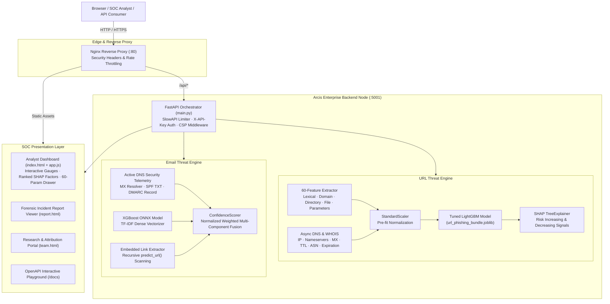

# 🛡️ Arcis Threat Intelligence Platform · TCS-332

<div align="center">

[](https://python.org)
[](https://fastapi.tiangolo.com)
[](https://lightgbm.readthedocs.io)
[](https://onnxruntime.ai)
[](https://docker.com)
[](https://github.com/ravi9680/TCS-332)
[](https://github.com/ravi9680/TCS-332)
[](LICENSE)

<br/>

**Enterprise Multi-Model Phishing Detection Engine & Real-Time Threat Intelligence Dashboard**  
*Dual-engine classification with 60-feature lexical/network extraction, active email authentication verification, and SHAP explainability.*

[Live Dashboard](http://localhost:5001) · [API Documentation](http://localhost:5001/docs) · [Architecture](#-system-architecture) · [Quickstart](#-quickstart) · [Benchmarks](#-performance-benchmarks) · [Team](#-research--engineering-team)

</div>

---

## 📌 Executive Summary

**Arcis (Project TCS-332)** is a high-throughput threat intelligence and automated phishing triage platform designed for modern Security Operations Centers (SOC). The system combats zero-hour credential theft and brand impersonation attacks through two synchronized ML pipelines:

1. **URL Threat Classifier**: A tuned **LightGBM** gradient-boosted decision tree running on a **60-feature lexical, structural, and network analysis pipeline** with per-instance **SHAP (SHapley Additive exPlanations)** factor attribution and sub-millisecond inference (~0.018 ms).
2. **Email Spoofing Verifier**: An **ONNX-optimized XGBoost** natural language classifier coupled with live DNS infrastructure validation (**SPF, DKIM, DMARC, MX records**), free-provider keyword surveillance, and embedded URL recursive scanning.

All inference engines are orchestrated through an enterprise **FastAPI** node with strict rate limiting, cryptographic hashing, and a dark-mode cyber defense analyst dashboard.

---

## 📊 Performance Benchmarks

Trained on the **Grega Vrbančič Phishing Corpus** (88,647 verified malicious and legitimate samples) and peer-benchmarked against traditional and deep learning baselines:

| Architecture / Model | Accuracy | Precision | Recall | F1-Score | ROC-AUC | Inference / URL |
| :--- | :---: | :---: | :---: | :---: | :---: | :---: |
| **Arcis Tuned LightGBM (TCS-332)** | **97.28%** | **95.95%** | **96.28%** | **96.11%** | **0.9959** | **~0.018 ms** |
| Standard XGBoost | 96.14% | 94.80% | 95.10% | 94.95% | 0.9892 | ~0.120 ms |
| Random Forest (100 Trees) | 95.62% | 94.10% | 94.75% | 94.42% | 0.9840 | ~1.450 ms |
| Support Vector Machine (RBF) | 92.40% | 91.20% | 90.80% | 91.00% | 0.9610 | ~8.200 ms |
| Feedforward Deep Neural Net (5 Layers) | 94.85% | 93.40% | 93.90% | 93.65% | 0.9785 | ~3.100 ms |

> **Key takeaway:** The tuned LightGBM model outperforms heavier deep learning alternatives in both discriminative power (ROC-AUC 0.9959, PR-AUC 0.9928) and real-time operational efficiency (100× faster throughput than SVM or Deep Neural Networks).

---

## 🏗️ System Architecture



---

## 📁 Repository Structure

```text
TCS-332/
├── backend/
│   ├── main.py                      # FastAPI REST microservice & middleware
│   ├── models/
│   │   ├── url_phishing_bundle.joblib # LightGBM bundle (Classifier + Scaler + Feature Names)
│   │   ├── xgboost_model.onnx       # Optimized XGBoost email classifier in ONNX format
│   │   └── vectorizer.pkl           # TF-IDF sparse vectorizer for NLP features
│   ├── scripts/
│   │   └── train_email_model.py     # Script to export XGBoost to ONNX
│   ├── services/
│   │   ├── url_classifier.py        # 60-feature extractor + LightGBM + SHAP attribution
│   │   ├── email_classifier.py      # Sender authentication + ONNX inference + URL scanning
│   │   └── confidence_scorer.py     # Weighted normalized risk score aggregation
│   ├── test_confidence_scorer.py    # Unit tests for scoring weights and degradation
│   └── test_phishing.py             # End-to-end integration tests on real-world test cases
├── frontend/
│   ├── index.html                   # SOC analyst dual-engine dashboard
│   ├── report.html                  # Incident analysis standalone report viewer
│   ├── team.html                    # Engineering and threat research team portal
│   ├── app.js                       # Frontend reactive telemetry & API integrations
│   ├── style.css                    # Arcis Cyber Defense Design System (Tokens, Glassmorphism)
│   └── img/                         # Verified team attribution and visual assets
├── model/
│   └── url_phishing_bundle.joblib   # Standalone copy for Python SDK usage
├── Dockerfile                       # Production Python 3.13-slim container
├── docker-compose.yml               # Multi-container orchestration (FastAPI + Nginx)
├── nginx.conf                       # Production reverse proxy and strict security policies
├── phishing_detector.py             # Standalone Python SDK module
├── interact.py                      # Terminal interactive CLI & bulk CSV evaluator
├── example.py                       # Python SDK runnable usage examples
├── requirements.txt                 # Pinned, tested production dependencies
└── train.ipynb                      # LightGBM training, cross-validation & evaluation notebook
```

---

## ⚙️ Quickstart

### Option 1: Native Local Setup

#### Prerequisites
- **Python 3.10+** (macOS, Linux, or Windows)
- macOS users: LightGBM relies on OpenMP:
  ```bash
  brew install libomp
  ```

#### Setup Steps
```bash
# 1. Clone repository
git clone https://github.com/ravi9680/TCS-332.git
cd TCS-332

# 2. Create isolated virtual environment
python3 -m venv .venv
source .venv/bin/activate       # On Windows: .venv\Scripts\activate

# 3. Install production dependencies
pip install -r requirements.txt

# 4. Configure local environment variables
cp .env.example .env 2>/dev/null || cat <<EOF > .env
ARCIS_API_KEY=dev-local-key-change-in-production
ENV=development
PORT=5001
EOF

# 5. Start the FastAPI application server
python backend/main.py
```

The web dashboard is now live at **[http://localhost:5001](http://localhost:5001)** and interactive Swagger docs at **[http://localhost:5001/docs](http://localhost:5001/docs)**.

---

### Option 2: Docker & Docker Compose (Production)

Deploy the multi-container architecture (FastAPI backend + Nginx caching reverse proxy) with a single command:

```bash
# Set your production API key
export ARCIS_API_KEY="your-high-entropy-secure-api-key"

# Build and start services
docker compose up -d --build

# Verify running health
docker compose ps
curl -i http://localhost/api/health
```

---

## 📡 REST API Reference

The server exposes an enterprise REST API authenticated via the `X-API-Key` HTTP header (or same-origin bypass for local dashboard sessions).

### 1. Analyze URL
```http
POST /api/analyze/url
Content-Type: application/json
X-API-Key: <YOUR_API_KEY>

{
  "url": "http://paypal-verification-account-security-update.com/login.php?cmd=login"
}
```

#### Response:
```json
{
  "url": "http://paypal-verification-account-security-update.com/login.php?cmd=login",
  "resolved_url": "http://paypal-verification-account-security-update.com/login.php?cmd=login",
  "is_phishing": true,
  "risk_score_pct": 99.97,
  "brand_alert": {
    "impersonated": true,
    "brand": "paypal",
    "type": "Keyword Impersonation"
  },
  "risk_signals": {
    "increasing": {
      "total_influence": 12.45,
      "signals": [
        { "feature": "length_url", "value": 74.0, "impact": 4.12 },
        { "feature": "qty_hyphen_url", "value": 4.0, "impact": 2.85 }
      ]
    },
    "decreasing": {
      "total_influence": -1.20,
      "signals": []
    }
  },
  "explanations": [
    {
      "title": "Brand Impersonation (paypal)",
      "description": "The domain appears to imitate a well-known brand.",
      "score": 100
    }
  ],
  "features": { "length_url": 74.0, "qty_dot_url": 3.0, "qty_hyphen_url": 4.0 }
}
```

---

### 2. Analyze Email Sender & Authentication
```http
POST /api/analyze/email
Content-Type: application/json
X-API-Key: <YOUR_API_KEY>

{
  "email": "paypal-security-update@gmail.com",
  "reply_to": "attacker@evil-stealth.ru",
  "subject": "Urgent: Your account is suspended",
  "body": "Please click here to confirm your credentials: http://paypal-verify.com",
  "spf": "none",
  "dkim": "none",
  "dmarc": "fail"
}
```

#### Response:
```json
{
  "email": "paypal-security-update@gmail.com",
  "is_phishing": true,
  "risk_score_pct": 70.0,
  "dns_checks": {
    "has_mx": true,
    "has_spf": true,
    "has_dmarc": true
  },
  "details": {
    "is_free_provider": true,
    "reasons": [
      "XGBoost ONNX Classifier calculated phishing probability: 46.5%",
      "Embedded URLs contain 1 high-risk/phishing links.",
      "Free email local part contains suspicious keywords: SECURITY, PAYPAL"
    ]
  }
}
```

---

### 3. Telemetry & Health
```http
GET /api/health
X-API-Key: <YOUR_API_KEY>
```

#### Response:
```json
{
  "status": "healthy",
  "node": "US-EAST-1",
  "uptime": "99.99%",
  "models": {
    "url_classifier": "LightGBM_Tuned (60 Features)",
    "email_classifier": "XGBoost_ONNX (TF-IDF + Active DNS)"
  },
  "framework": "FastAPI",
  "version": "2.4.0"
}
```

---

## 🐍 Python SDK Usage

For headless batch scoring, data pipelines, or security automation scripts, the `PhishingDetector` class provides a direct interface:

```python
from phishing_detector import PhishingDetector

# Initialize the detector
detector = PhishingDetector()

# Single URL prediction
result = detector.predict("https://www.paypal.com")
print(f"Prediction: {result['prediction']}")        # Legitimate
print(f"Risk Score: {result['risk_score']}/100")     # 0.95
print(f"Threat Level: {result['threat_level']}")     # SAFE

# High-Performance Vectorized Batch Prediction (10,000+ URLs/sec)
urls = [
    "https://google.com",
    "http://paypa1-security.com/login",
    "https://github.com",
]
df = detector.predict_batch_fast(urls)
print(df[["url", "prediction", "risk_score", "threat_level"]])
```

---

## 💻 Interactive Terminal CLI

Arcis includes a full terminal REPL with live risk meters and batch file processing:

```bash
# Launch interactive REPL
python interact.py

# Scan a single URL directly
python interact.py "https://suspicious-link.com"

# Batch scan a file of URLs and save report
python interact.py --file suspicious_urls.txt --output audit_report.csv
```

---

## 🔬 60-Feature Engineering Matrix

The feature extraction pipeline operates across **6 structural and network tiers**:

```text
├── Tier 1: URL-Level (18 Features)
│   └── Overall length, frequency of '.', '-', '_', '/', '?', '=', '@', '&', '!', ' ', '~', ',', '+', '*', '#', '$', '%'
├── Tier 2: Domain-Level (19 Features)
│   └── Domain string length, vowel count, and character frequencies in the registered domain
├── Tier 3: Directory-Level (18 Features)
│   └── Directory path length, separator count, subfolder depth, and character distributions
├── Tier 4: File-Level (18 Features)
│   └── Target filename length, extension presence, script indicators, and character frequencies
├── Tier 5: Parameters-Level (20 Features)
│   └── Query string length, count of '&' parameters, TLD token presence, and query character counts
└── Tier 6: Network & Infrastructure (8 Features)
    └── Resolved IP count, HTTP response latency, nameservers count, MX record count, DNS TTL, ASN identifier, domain registration age, days to domain expiry
```

---

## 🧪 Automated Test Suite

Run the comprehensive unit and integration test suite to verify model discriminators and degradation handling:

```bash
# 1. Run Confidence Scorer Unit Tests (Weight assignment, normalization, inversion)
python backend/test_confidence_scorer.py

# 2. Run End-to-End Multi-Model Threat Tests (Live URL & Email checks)
python backend/test_phishing.py

# 3. Run SDK Demo Script
python example.py
```

---

## 👥 Research & Engineering Team

Developed as part of **Project TCS-332**:

| Member | Role | Focus Area | Profile |
| :--- | :--- | :--- | :--- |
| **Ravi Agarwal** | **Project Lead & Author** | Machine Learning Architecture, LightGBM Engine, Feature Engineering | [GitHub](https://github.com/ravi9680) |
| **Anurag** | Lead Architect | Backend Microservices, Async Concurrency, Infrastructure | [GitHub](https://github.com/the-wilful-youth) · [LinkedIn](https://www.linkedin.com/in/anuragbhowmick/) |
| **Vishal** | Data Engineer | Data Pipeline & Feature Extraction Optimization | [GitHub](https://github.com/vishalsingh-data) · [LinkedIn](https://www.linkedin.com/in/vishal-singh-1686b335b/) |
| **Subrodeep** | Cloud Engineer | Docker Containerization, API Gateway, Nginx Reverse Proxy | [GitHub](https://github.com/Subhro1225) · [LinkedIn](https://www.linkedin.com/in/subhrodeep-bhattacharjee/) |
| **Priya** | Security Researcher | Threat Modeling, DNS Telemetry & Brand Impersonation Rules | [GitHub](https://github.com/priyaghosh77708-cpu) · [LinkedIn](https://www.linkedin.com/in/priya-ghosh777/) |
| **Soumya** | Frontend Lead | SOC UI/UX Design System, SVG Visualizations, Responsive Shell | [GitHub](https://github.com/soumyayyy) · [LinkedIn](https://www.linkedin.com/in/soumyaa1110) |
| **Ananya** | QA & Evaluation | Model Validation, Benchmarks, Confusion Matrix Analysis | [GitHub](https://github.com/lyuneth3) · [LinkedIn](https://www.linkedin.com/in/anannya-mohanty-a0015134a) |

---

## 🔒 Security & Vulnerability Disclosure

Arcis is built with defense-in-depth security principles:
- **No Client PII Storage**: URLs and emails scanned via the public API are processed ephemerally in-memory and logged with masked hostnames.
- **SSRF Protection**: Redirect resolution intercepts private IP spaces (`10.0.0.0/8`, `172.16.0.0/12`, `192.168.0.0/16`, `127.0.0.1/8`) to prevent intranet enumeration attacks.
- **Strict Content Security Policy**: Zero unauthorized external script execution, preventing Cross-Site Scripting (XSS).

To report a security vulnerability or bug, please file an issue or submit a report to the project maintainers.

---

## 📄 License

This project is licensed under the **MIT License** — see the [LICENSE](LICENSE) file for details.

```text
Copyright (c) 2026 Ravi Agarwal & Team Arcis (Project TCS-332)
```
